

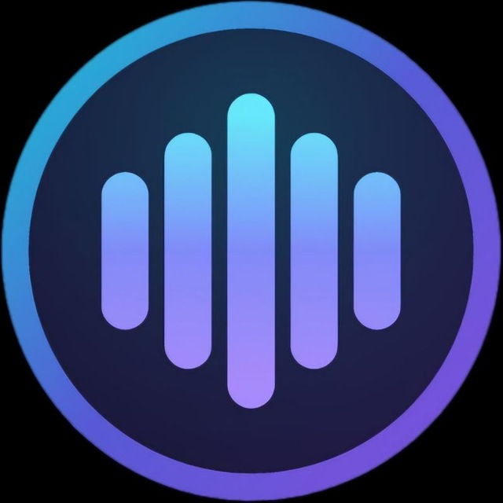

# Resonāda

### True Bit-Perfect, Reference-Grade Audio Engine & Player for Android

**[⬇️ Download Latest APK (v2.1.0.1 · Saṃskāra)](https://github.com/resonada/resonada/releases/latest)**

---

## 📽️ Video Demonstration

Experience Resonāda in real time — streaming bit-perfect audio over USB Audio Class (UAC2), inspecting live signal paths, executing laboratory-grade audio fidelity metering, and tuning 32-band parametric DSP.

<a href="https://files.catbox.moe/2v2wzj.mp4" target="_blank" rel="noopener noreferrer">
  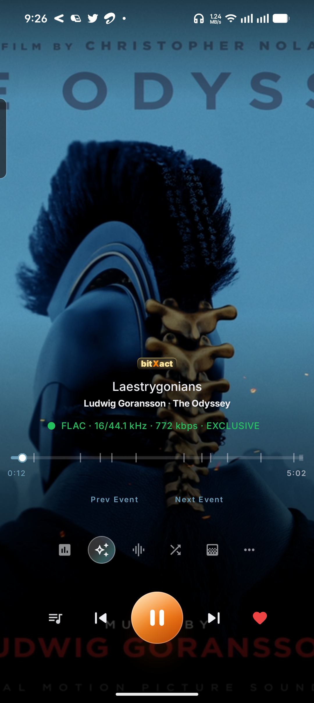
</a>

  

[-E0B567?style=for-the-badge)](https://files.catbox.moe/2v2wzj.mp4)

 

**[▶️ Watch / Stream Online (Direct MP4)](https://files.catbox.moe/2v2wzj.mp4)** &nbsp;•&nbsp; **[⬇️ Download Raw Video (82.9 MB)](https://github.com/resonada/resonada/raw/main/assets/screen-20261026-214900.mp4)**

<video src="https://files.catbox.moe/2v2wzj.mp4" width="85%" controls="controls" poster="assets/Screenshot_20261026-212700.png">
  Your browser does not support the video tag. View online: <a href="https://files.catbox.moe/2v2wzj.mp4">Demonstration Video (MP4)</a>
</video>

 

Full 1080×2412 60 FPS walkthrough featuring live bitXact USB playback, signal flow, and analysis suite.

---

## ✨ Overview

**Resonāda** is a high-fidelity local and streaming music player engineered for audiophiles, sound designers, and discerning listeners who demand absolute sonic transparency. Most Android audio players route audio through the standard Android system framework, where audio undergoes uninvited sample-rate conversion, floating-point truncation, mixer dithering, or volume compression inside Android's `AudioFlinger` and OEM hardware abstraction layers (HAL).

Resonāda solves this at the root. It incorporates an independent, user-space **USB Audio Class (UAC1/UAC2) driver** streaming isochronous audio directly to your external DAC via asynchronous USB endpoints (`usbdevfs`), completely bypassing the operating system mixer bit-for-bit.

Complementing its bit-exact transmission is an **on-device acoustic laboratory** that inspects your audio files before and during playback. From detecting upscaled lossy transcodes ("fake FLACs") to real-time Nyquist spectrograms, EBU R128 loudness metrics, true-peak inter-sample overs, and live stage-by-stage signal telemetry, Resonāda proves the integrity of every bit reaching your ears.

> **The bitXact Promise:** The gold `bitXact` seal illuminates only when the complete audio pipeline is verified pristine — zero resampling, zero software attenuation, and zero DSP coloring.

---

## 📸 Visual Showcase

| Now Playing (`bitXact`) | Personalized Home | Signal Path Inspector |
| :---: | :---: | :---: |
|  | 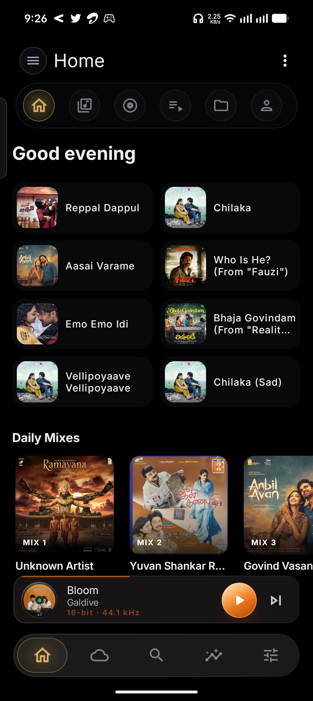 | 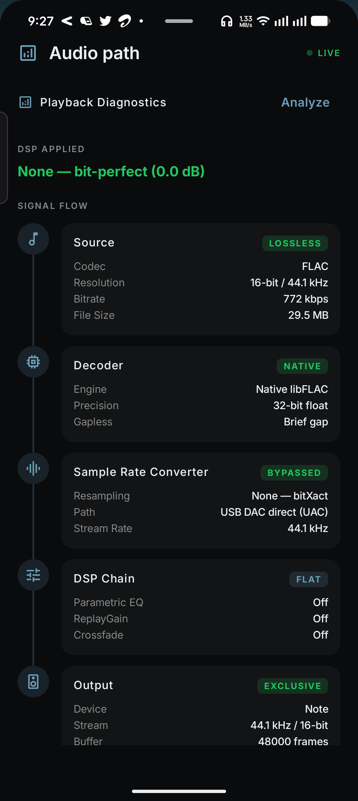 |
| **Audio X-Ray** | **Acoustic Fidelity Analysis** | **Calibrated Spectrogram** |
| 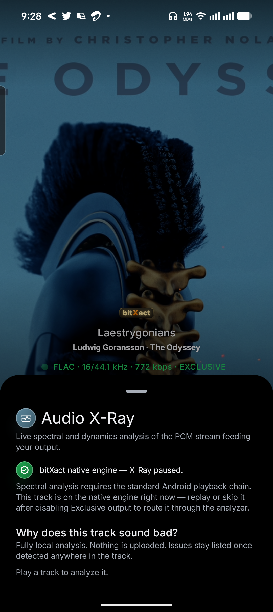 | 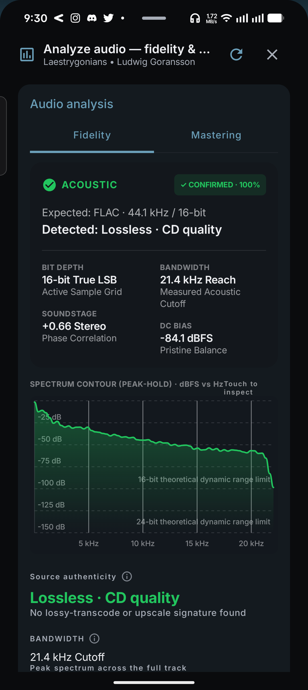 | 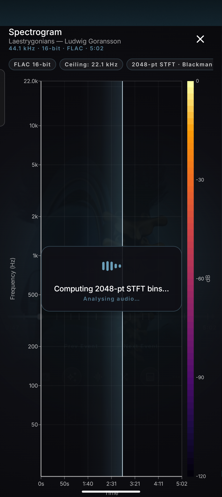 |
| **Parametric EQ / DSP** | **USB DAC Hardware Details** | **Synced Lyrics & Liquid Canvas** |
| 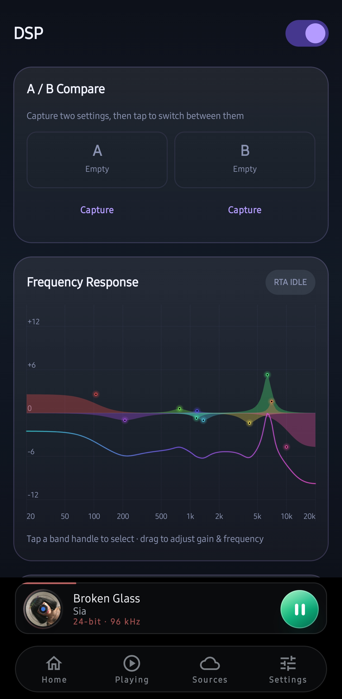 | 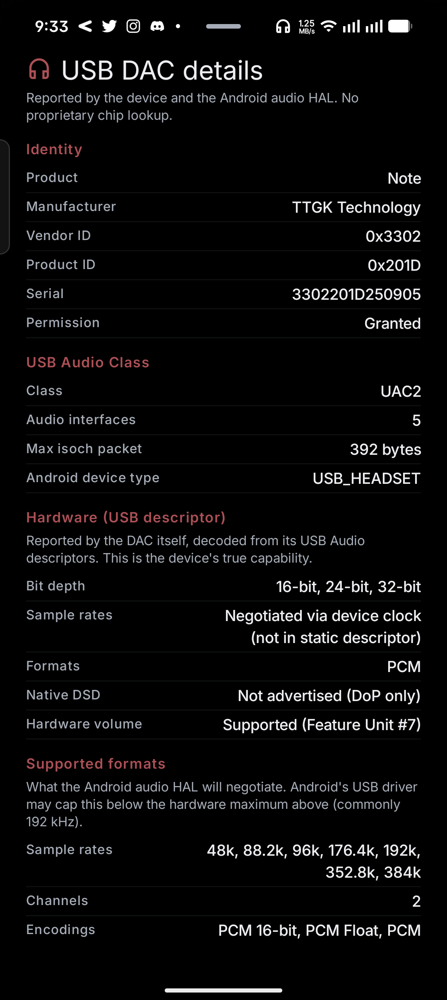 | 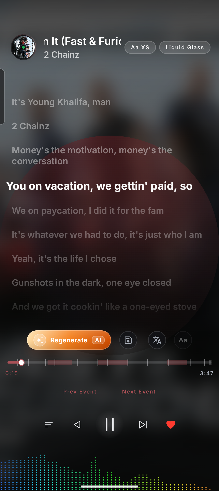 |
| **Per-Track Quick Tools** | **Lossless Music Library** | **Navigation Drawer & Hub** |
| 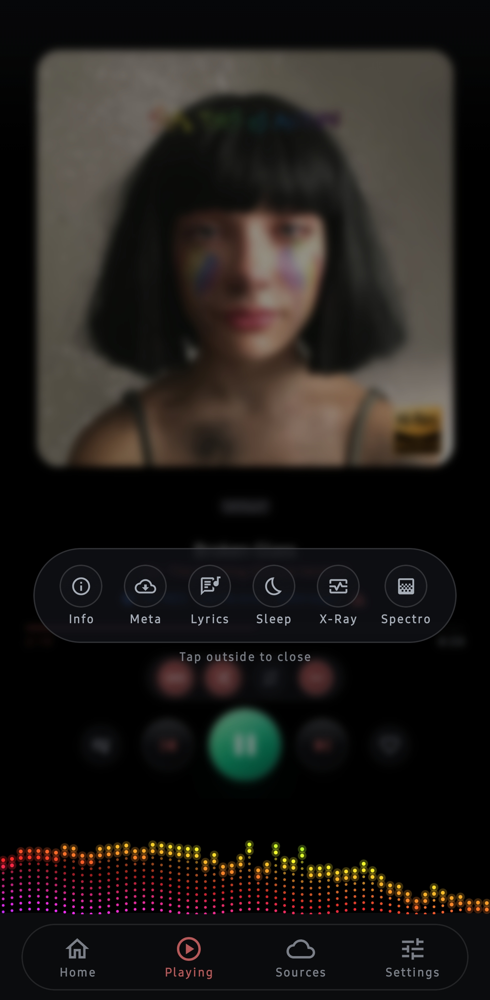 | 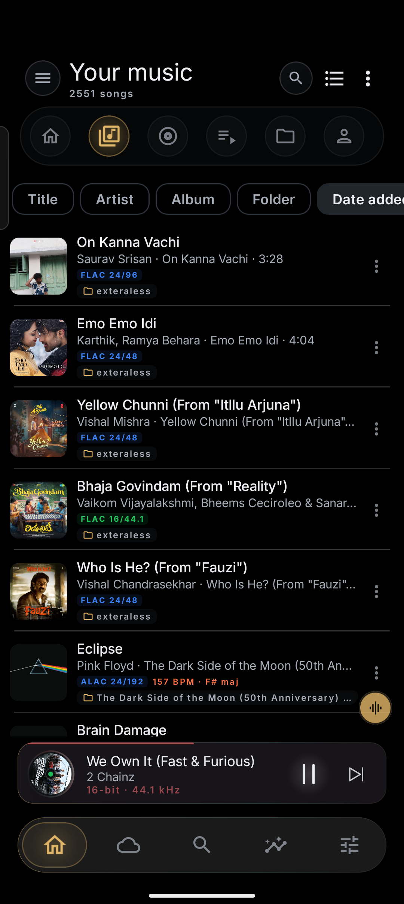 | 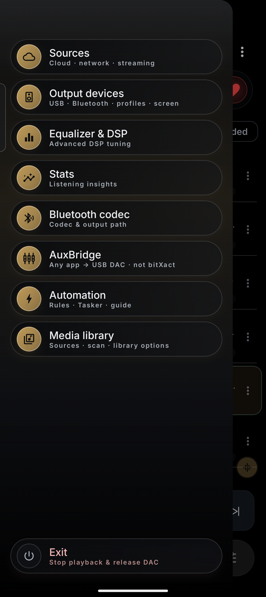 |

---

## 🌟 Comprehensive Architecture & Feature Tour

### 🔊 1. True Bit-Perfect Engine — `bitXact`
- **Native User-Space USB Audio Driver (UAC1 / UAC2):** Streams asynchronous isochronous PCM and DSD packets directly to USB audio interfaces via Linux `usbdevfs`. Completely circumvents Android `AudioFlinger`, mixer sample-rate conversions, and OEM audio policies.
- **Hardware Clock Matching:** Dynamically reclocks connected DACs to match the track's native sampling frequency (44.1, 48, 88.2, 96, 176.4, 192, 352.8, 384 kHz, and beyond) without intermediate resampling.
- **Native 1-Bit DSD & DoP:** Decodes `.dsf`, `.dff`, and full **DSD ISO disc images** natively. Direct bitstream pass-through for DSD64, DSD128, DSD256, and DSD512. Automatically recognizes DSD packed in PCM (DoP) containers inside FLAC/WAV/AIFF headers, avoiding harsh noise bursts.
- **Multi-Channel Compressed DSD:** Full native multi-threaded decompression of compressed 1-bit audio streams found in multi-channel DSD disc images.
- **Official Monkeys Audio (APE) & WavPack Engines:** Embedded official libdemac and libwavpack implementations with APEv2 metadata read/write, gapless playback, seek-table precision, and WavPack-DSD high-rate PCM playback.
- **Hardware Volume Integration:** Communicates directly with USB Audio Class Feature Units (#7 / #10). Adjusts the DAC's analog/digital hardware registers directly over USB control transfers, preserving digital bit-depth. Falls back to flat TPDF (Triangular Probability Density Function) dithered attenuation when software scaling is required.
- **Dedicated DAP & Direct HAL Integration:** Supports direct non-USB hardware paths on specialized audiophile DAPs (e.g. custom FPGA direct output) and internal hi-res hardware direct paths. Signals engagement with dedicated purple **Direct BitXact** or teal **Native Exclusive** seals.

---

### 🔬 2. Real-Time Signal Path & Acoustic Diagnostic Suite
- **Stage-by-Stage Signal Path Inspector:** Live inspection window mapping every transformation in the audio pipeline:
  `Source (Format/Rate) ➔ Decoder (Precision) ➔ Sample Rate Converter ➔ DSP Chain ➔ Output (Hardware Endpoint)`.
- **Signal Integrity Scoring:** Generates an algorithmic 0–100 Signal Integrity rating. Verifies whether Android SRC is bypassed, bitXact path is active, output is clipping-free, and measures hardware output latency in milliseconds.
- **Audio X-Ray:** Live spectral and dynamic power distribution analysis across discrete acoustic frequency registers (Sub-bass, Bass, Mids, Treble, Stereo Width, Dynamic Range, and Compression). Includes heuristic root-cause explanations ("Why does this track sound bad?").
- **Laboratory-Grade Fidelity Metering & Transcode Detection:**
  - **Authenticity Verification:** Distinguishes genuine high-resolution recordings from lossy transcodes and upscaled files using spectral roll-off analysis and harmonic noise floors.
  - **Bit Depth Inspection:** Analyzes raw sample grids to determine true effective bit depth vs padded LSBs.
  - **Dynamic Range (DR Meter):** Measures crest factor and whole-track dynamic range ratings (DR1 to DR20+).
  - **EBU R128 & ITU-R BS.1770-4 Compliance:** Calculates Integrated Loudness (LUFS), Loudness Range (LRA), and True Peak (dBTP) with 4× oversampled inter-sample clipping detection.
- **Calibrated Nyquist Spectrogram:** High-resolution time-frequency visualizer powered by 2048-to-8192 point Short-Time Fourier Transforms (STFT). Features Blackman windowing, interactive tap-to-inspect dBFS readouts, and independent channel isolation (Stereo, Left, Right, Mid, and **Side** channel analysis to expose joint-stereo compression artifacts).

---

### 🎚️ 3. Universe Parametric DSP Suite
- **Dynamic Node Reordering:** Drag-and-drop signal processor cards to customize the real-time DSP sequence with zero memory reallocation on the audio thread. Full profiles exportable/importable via JSON.
- **32-Band Parametric Equalizer (PEQ):** Robert Bristow-Johnson (RBJ) biquad filter implementations with real-time click-free coefficient interpolation.
- **Built-in AutoEQ Integration:** Instant access to thousands of measured headphone correction profiles (oratory1990, Crinacle) with automated weekly upstream index updates.
- **On-Device Target Curve Optimizer:** Import Squiglink/CSV frequency response measurements and automatically generate compensatory PEQ filters to match Harman Target curves (In-Ear / Over-Ear) directly on device.
- **Convolution & Room Correction:** Low-latency partitioned convolution engine supporting custom impulse response (WAV) files for room simulation, speaker crossfeed, and headphone correction.
- **Binaural HRTF & Virtual Loudspeakers:** Calibrated dummy-head HRTF impulse engine renders 2.0 stereo or folds 5.1/7.1 surround sound into realistic ±30° virtual listening rooms across 44.1–192 kHz.
- **Audiophile Precision Selector:** Toggle between standard 32-bit floating point and studio-grade 64-bit double-precision processing pipelines.

---

### 🌉 4. AuxBridge — Universal USB DAC Audio Intercept
- **System-Wide Audio Routing:** Stream audio from any third-party app (streaming services, web browsers, media apps, games) directly through Resonāda's custom USB DAC driver.
- **Custom Capture Rates:** Select sample rate clocks (44.1, 48, 96, 192 kHz) to drive external DACs cleanly without OEM resampling interference.
- **Transparent Labelling:** Honestly designated as non-bitXact due to upstream Android system mixing, while delivering audiophile-grade DAC pass-through, hardware volume control, and DSP integration for foreign audio streams.

---

### 📚 5. High-Resolution Library & Discovery Intelligence
- **High-Performance Filesystem Scanner:** Multi-threaded metadata scanner with direct filesystem access (`/storage/emulated/0`), bypassing Android MediaStore limitations. Supports embedded tags, sidecar `.lrc` lyrics, folder artwork hierarchies, and CUE album sheet parsing.
- **Smartlists & Rule Engine:** Construct expressive, multi-condition rule-based playlists with logical AND/OR matching, metadata constraints, and dynamic track limiters.
- **Library Health Audit:** Scans whole libraries to identify duplicates, untagged releases, missing album artwork, and low-bitrate re-rip candidates.
- **Discovery Intelligence ("Sounds Like" & Daily Mixes):** Local, acoustic similarity algorithm recommending tracks based on harmonic key, tempo (BPM), acoustic envelope, and genre continuity without network queries.
- **Full Tag Editor & AcoustID Lookup:** Edit tags, embed high-resolution cover art, calculate ReplayGain 2.0 / EBU R128 track gains, and query MusicBrainz / AcoustID acoustic fingerprints.

---

### 🎤 6. Synced Lyrics & Liquid Canvas
- **Word-Level Beat Synchronization:** Millisecond-accurate word-by-word karaoke highlighting following rhythmic transients.
- **Multi-Provider Aggregation:** Instant fallback search across LrcLib, Genius, Musixmatch, Lyrics.ovh, QuickLRC, NetEase, and QQ Music.
- **Offline / Cloud Translation & Phonetics:** On-device neural translation into local languages alongside multi-script phonetic romanization (CJK, Cyrillic, Devanagari).
- **Immersive Canvases:** 10 responsive backdrop themes (Liquid Glass, Obsidian Void, Adaptive Chrome, Astral Glow, Cinema Wash) rendering dynamic refractive lighting effects.

---

### ☁️ 7. Sources, Network & Automation
- **Native Music Server Client:** Dedicated client interfaces for **Subsonic**, **OpenSubsonic**, **Navidrome**, **Jellyfin** (with PIN Quick Connect), **Emby**, and **Plex**.
- **Network Storage Protocols:** Direct streaming from SMB, SFTP, FTP, WebDAV shares, Dropbox, and DLNA/UPnP media servers.
- **Lossless Internet Radio:** Curated stations including Radio Paradise with lossless 16-bit/44.1 kHz FLAC live streams and real-time DJ block metadata.
- **Automation & Integrations:** Built-in condition-action rule engine (e.g. `When USB DAC connects ➔ Enable bitXact mode`), native Tasker/MacroDroid plugin, Discord Rich Presence, Android Auto dashboards, and interactive desktop widgets.

---

## 📋 Comprehensive Screenshot Directory & Feature Mapping

The table below catalogs every screenshot captured from the live application, mapping the source file to its established semantic convention, corresponding architectural subsystem, and interface details:

| # | File Name | Established Semantic Identifier | Feature / UI Section | Interface Description & Key Telemetry |
|:---:|:---|:---|:---|:---|
| **01** | [`Screenshot_20261026-212602.png`](assets/Screenshot_20261026-212602.png) | `Home.png` | **Personalized Home Dashboard** | Time-of-day greeting, recent playback history grid, Daily Mixes (Mix 1–3), active MiniPlayer with format pill, and liquid bottom navigation. |
| **02** | [`Screenshot_20261026-212619.png`](assets/Screenshot_20261026-212619.png) | `Home-Discover.png` | **Home Discovery Stream** | "Rediscover" recommendations, "Made for you" artist groupings, and recent listening session history. |
| **03** | [`Screenshot_20261026-212700.png`](assets/Screenshot_20261026-212700.png) | `NowPlaying.png` | **Now Playing (bitXact Immersive)** | Full-bleed album art canvas, gold `bitXact` seal, `FLAC · 16/44.1 kHz · 772 kbps · EXCLUSIVE` badge, semantic seekbar with chorus tick marks, and playback controls. |
| **04** | [`Screenshot_20261026-212714.png`](assets/Screenshot_20261026-212714.png) | `SignalPath-Flow.png` | **Signal Path (Pipeline Stages)** | Live stage-by-stage pipeline: Source FLAC ➔ Native libFLAC decoder ➔ Sample Rate Converter (Bypassed) ➔ Flat DSP ➔ Exclusive USB endpoint. |
| **05** | [`Screenshot_20261026-212725.png`](assets/Screenshot_20261026-212725.png) | `SignalPath-Integrity.png` | **Signal Integrity & Diagnostics** | Signal Integrity score (100/100), Android SRC status (Bypassed), clipping monitor (Clean), buffer latency (34.8 ms), and "Fix My Sound" reset action. |
| **06** | [`Screenshot_20261026-212839.png`](assets/Screenshot_20261026-212839.png) | `NowPlaying-Visualizer.png` | **Now Playing with Spectrum Ribbon** | Real-time dynamic multicoloured audio frequency spectrum visualizer ribbon animating smoothly along the bottom navigation boundary. |
| **07** | [`Screenshot_20261026-212857.png`](assets/Screenshot_20261026-212857.png) | `AudioXRay.png` | **Audio X-Ray Modal Sheet** | Live spectral and dynamic power distribution sheet with bitXact engine pause telemetry and heuristic "Why does this track sound bad?" inspector. |
| **08** | [`Screenshot_20261026-213038.png`](assets/Screenshot_20261026-213038.png) | `FidelityAnalyzer-Acoustic.png` | **Fidelity & Acoustic Integrity** | Confirmed 100% Lossless CD Quality verdict, 16-bit true LSB grid, stereo correlation (+0.66), 21.4 kHz cutoff reach, and pristine DC bias (-84.1 dBFS). |
| **09** | [`Screenshot_20261026-213048.png`](assets/Screenshot_20261026-213048.png) | `FidelityAnalyzer-Contour.png` | **Spectrum Contour & Provenance** | Peak-hold spectrum curve plotted against theoretical dynamic range limits with transcode verification, export, and `.fidelity.json` sidecar saving. |
| **10** | [`Screenshot_20261026-213055.png`](assets/Screenshot_20261026-213055.png) | `FidelityAnalyzer-Mastering.png` | **Mastering Dynamics & EBU R128** | Dynamic Range (DR5), Peak levels (-0.21 dBFS), True Peak (-0.12 dBTP), RMS power, Integrated Loudness (-9.5 LUFS), and Loudness Range (LRA 14.8 LU). |
| **11** | [`Screenshot_20261026-213107.png`](assets/Screenshot_20261026-213107.png) | `Spectrogram-Compute.png` | **Calibrated STFT Spectrogram** | 2048-point STFT time-frequency spectrogram up to 22.1 kHz Nyquist ceiling with Blackman window, full-scale calibrated dBFS gradient (-120 to 0 dB), and live bin computation. |
| **12** | [`Screenshot_20261026-213113.png`](assets/Screenshot_20261026-213113.png) | `Spectrogram-MidSide.png` | **Multi-Channel Spectrogram** | Channel separation view isolating Stereo, Left, Right, Mid, and Side channels with logarithmic frequency axis to detect joint-stereo artifacts and fake-stereo upmixes. |
| **13** | [`Screenshot_20261026-213131.png`](assets/Screenshot_20261026-213131.png) | `Discovery-SoundsLike.png` | **"Sounds Like" Discovery Engine** | Harmonic key, tempo, and acoustic similarity engine queuing library tracks that closely match the current selection. |
| **14** | [`Screenshot_20261026-213339.png`](assets/Screenshot_20261026-213339.png) | `USBDACDetails-Hardware.png` | **USB DAC Identity & Descriptors** | Hardware-level enumeration: Product identity, VID/PID, UAC2 classification, isochronous packet size (392 bytes), and decoded hardware endpoint descriptors. |
| **15** | [`Screenshot_20261026-213417.png`](assets/Screenshot_20261026-213417.png) | `USBDACDetails-Capabilities.png` | **USB DAC Supported Formats** | Full hardware capabilities: 16/24/32-bit PCM, DSD over PCM (DoP), Feature Unit #7 hardware analog volume support, and Android audio HAL negotiated sample rates up to 384 kHz. |
| **16** | [`Screenshot_20261026-213428.png`](assets/Screenshot_20261026-213428.png) | `USBDACDetails-LiveStream.png` | **USB Stream Health & Clock Drift** | Live stream telemetry: Native USB UAC exclusive state, hardware volume status, UAC 2.0 bInterval, 0 PPM clock drift, and Android 14 bit-perfect mixer lock state. |
| **17** | [`Screenshot_20261026-213500.png`](assets/Screenshot_20261026-213500.png) | `Lyrics-Synced.png` | **Beat-Synced Lyrics & Liquid Glass** | Real-time word-level synchronized karaoke lyrics with beat tracking, syllable sweep highlight, typography settings (XS–XL, Sans/Serif/Mono), and Liquid Glass backdrop. |
| **18** | [`Screenshot_20261026-213506.png`](assets/Screenshot_20261026-213506.png) | `Lyrics-SourcePicker.png` | **Multi-Provider Lyrics Selector** | In-app lyric provider engine supporting LrcLib, Musixmatch, Genius, Lyrics.ovh, QuickLRC, NetEase, and QQ Music with word-level and plain-text preview. |
| **19** | [`Screenshot_20261026-213522.png`](assets/Screenshot_20261026-213522.png) | `Tools-CustomizePill.png` | **Quick Tools Action Pill Customizer** | Drag-and-drop tool configuration allowing up to 5 prioritized tools in the floating pill (Fidelity, Flow, Sounds like, Shuffle, Spectrogram, Repeat, Metadata, Lyrics, Sleep, Tempo). |
| **20** | [`Screenshot_20261026-213535.png`](assets/Screenshot_20261026-213535.png) | `Tools-Layout.png` | **Quick Tools Sheet Configuration** | Overflow sheet layout manager for Volume Studio, A–B Repeat, and specialized audiophile quick tools. |
| **21** | [`Screenshot_20261026-213553.png`](assets/Screenshot_20261026-213553.png) | `Sources-Overview.png` | **Unified Sources & Network Hub** | Central connectivity hub for local storage, UPnP/DLNA servers, Cast targets, Subsonic/Navidrome, WebDAV/SMB, and curated RSS audio news feeds. |
| **22** | [`Screenshot_20261026-213600.png`](assets/Screenshot_20261026-213600.png) | `Sources-RadioParadise.png` | **Lossless Radio Paradise Stream** | Live streaming FLAC 16-bit/44.1 kHz broadcast with interactive real-time DJ block metadata, upcoming playlist queues, and station channel selector. |
| **23** | [`Screenshot_20261026-213632.png`](assets/Screenshot_20261026-213632.png) | `Library-Tracks.png` | **Music Library — Lossless Tracks** | Complete track browser with audio format chips (FLAC 24/96, ALAC 24/192, DSD, BPM, musical key), sort orders, and filter criteria. |
| **24** | [`Screenshot_20261026-213650.png`](assets/Screenshot_20261026-213650.png) | `Library-Playlists.png` | **Playlists & M3U Management** | Auto-discovered storage playlists, custom manual lists, M3U import/export, and AI-assisted playlist generation. |
| **25** | [`Screenshot_20261026-213701.png`](assets/Screenshot_20261026-213701.png) | `Library-Folders.png` | **Hierarchical Folder Browser** | Direct storage tree navigation bypassing Android media store limitations, with breadcrumbs and active folder highlighting. |
| **26** | [`Screenshot_20261026-213706.png`](assets/Screenshot_20261026-213706.png) | `Library-Artists.png` | **Music Library — Artists Directory** | Alphabetical artist index with fast scrubber, track counts, favorite indicators, and multi-discography support. |
| **27** | [`Screenshot_20261026-213712.png`](assets/Screenshot_20261026-213712.png) | `Library-AlbumArtists.png` | **Dedicated Album Artists View** | Specialized Album Artist browsing separating individual contributing performers from primary release artists. |
| **28** | [`Screenshot_20261026-213718.png`](assets/Screenshot_20261026-213718.png) | `Library-ArtistDetail.png` | **Artist Dossier & Batch Mastering** | Comprehensive artist profile with biography, discography, one-tap batch BPM analysis, and whole-catalog EBU R128 loudness scanning. |
| **29** | [`Screenshot_20261026-213729.png`](assets/Screenshot_20261026-213729.png) | `Library-Timeline.png` | **Chronological Decade & Year Browser** | Release year and decade distribution histogram displaying track counts across chronological eras (2016–2026+). |
| **30** | [`Screenshot_20261026-213739.png`](assets/Screenshot_20261026-213739.png) | `Smartlists-Overview.png` | **Dynamic Smartlists Hub** | Rule-driven smart playlists with built-in presets (Recently Added, Instant Mix, Hi-Res, Verified Lossless) and instant playback. |
| **31** | [`Screenshot_20261026-213749.png`](assets/Screenshot_20261026-213749.png) | `Smartlists-RuleBuilder.png` | **Smartlist Rule Builder & Caps** | Advanced filter constructor with boolean matching (Match All / Any), metadata rules, sorting rules, duration caps, and track limits. |
| **32** | [`Screenshot_20261026-213814.png`](assets/Screenshot_20261026-213814.png) | `OutputDevices-Hub.png` | **Output Devices & Routing Drawer** | Device management drawer for switching between Phone Speaker, Hi-Res 3.5mm wired path, Bluetooth (with codec control), and USB DACs with saved profiles. |
| **33** | [`Screenshot_20261026-213822.png`](assets/Screenshot_20261026-213822.png) | `OutputDevices-USBTweaks.png` | **USB Tweaks & Exclusive Routing** | BitXact mode switches, AAudio MMAP exclusive output, auto-open on USB DAC connection, pause/resume triggers, call handling, and DSD mode selection. |
| **34** | [`Screenshot_20261026-213835.png`](assets/Screenshot_20261026-213835.png) | `OutputDevices-Diagnostics.png` | **USB Hardware Health & Diagnostics** | Low-level USB diagnostics: AudioFlinger sink state, physical USB hardware enumeration, interface validation, and troubleshooting guide. |
| **35** | [`Screenshot_20261026-213844.png`](assets/Screenshot_20261026-213844.png) | `Stats-Overview.png` | **Listening Stats & Scrobbling** | Listening telemetry dashboard: total play counts, playback duration (52h), active streaks, scrobble counters (Last.fm/ListenBrainz), and Listening DNA quality badge. |
| **36** | [`Screenshot_20261026-213850.png`](assets/Screenshot_20261026-213850.png) | `Stats-ListeningDNA.png` | **Listening DNA & Lossless Purity** | Detailed format distribution chart (FLAC 72%, ALAC, PCM 3%, Lossy 9%), average bitrate (1171 kbps), weekly discovery rates, and top genres. |
| **37** | [`Screenshot_20261026-213904.png`](assets/Screenshot_20261026-213904.png) | `LibraryHealth-ReRip.png` | **Library Health & Re-Rip Candidates** | Comprehensive audit displaying overall library lossless percentage (84%), duplicate detection, suspected fake hi-res files, and lowest quality re-rip candidates. |
| **38** | [`Screenshot_20261026-213907.png`](assets/Screenshot_20261026-213907.png) | `LibraryHealth-SkipIntel.png` | **Skip Intelligence & Habit Profiling** | Habit analysis tracking frequently skipped songs, completion percentages, and smart mix curation recommendations. |
| **39** | [`Screenshot_20261026-213928.png`](assets/Screenshot_20261026-213928.png) | `AuxBridge-Stream.png` | **AuxBridge Universal DAC Intercept** | Real-time audio routing capturing audio from third-party apps (browsers, streaming apps, games) and piping it through Resonāda's exclusive USB DAC driver at user-selected sample rates. |
| **40** | [`Screenshot_20261026-213936.png`](assets/Screenshot_20261026-213936.png) | `Automation-Rules.png` | **In-App Automation & Tasker Plugin** | Event-action rules engine (e.g. "When USB DAC connects ➔ Enable bitXact"), combined with native Tasker/MacroDroid plugin integration. |
| **41** | [`Screenshot_20261026-213941.png`](assets/Screenshot_20261026-213941.png) | `Navigation-Drawer.png` | **Unified Navigation Drawer** | System menu providing immediate access to Sources, Output Devices, Equalizer & DSP, Stats, Bluetooth Codec, AuxBridge, Automation, and Media Library. |
| **42** | [`Screenshot_20261026-213946.png`](assets/Screenshot_20261026-213946.png) | `Settings-LibraryScan.png` | **Media Library Settings & Full Scan** | Direct filesystem access controls, system ringtone/alarm filtering, background scan daemon, and full-library fidelity & mastering analysis toggles. |
| **43** | [`Screenshot_20261026-213951.png`](assets/Screenshot_20261026-213951.png) | `Settings-FidelitySidecars.png` | **Fidelity Analysis & Power Settings** | Sidecar persistence (`.fidelity.json`), CPU throttling during playback, low-battery auto-pause, pull-to-rescan, and folder path breadcrumbs. |
| **44** | [`Screenshot_20261026-213955.png`](assets/Screenshot_20261026-213955.png) | `Settings-CoverArtPriority.png` | **Artwork Hierarchy & Tag Policies** | Cover art resolution order (folder images vs embedded metadata), local animated video canvas priority, sidecar `.lrc` priority, and article stripping in sorting. |
| **—** | [`.github/ResonadaScreenshots/DSP0.jpg`](.github/ResonadaScreenshots/DSP0.jpg) | `DSP0.jpg` | **Parametric EQ Curve & A/B Compare** | Visual biquad filter response curve with draggable filter handles, live RTA analyzer, and instant A/B profile switching. |
| **—** | [`.github/ResonadaScreenshots/DSP1.jpg`](.github/ResonadaScreenshots/DSP1.jpg) | `DSP1.jpg` | **Equalizer & AutoEQ Catalog** | Graphic vs Parametric toggle, digital preamp gain slider, and in-app AutoEQ headphone measurement search. |
| **—** | [`.github/ResonadaScreenshots/DSP2.jpg`](.github/ResonadaScreenshots/DSP2.jpg) | `DSP2.jpg` | **Dynamics, Tone & Convolution** | Bass boost, loudness contour, compressor, peak limiter, binaural crossfeed, and impulse response convolution loader. |
| **—** | [`.github/ResonadaScreenshots/DSP3.jpg`](.github/ResonadaScreenshots/DSP3.jpg) | `DSP3.jpg` | **Live RTA Spectrum & DSP Profiles** | Multi-band Real-Time Analyzer (RTA LIVE), saved per-device DSP profiles, and real-time processing telemetry. |

---

## 🎵 Audio Format Support Matrix

| Format Group | Formats & Codecs Supported | Audio Engine Transmission Path |
|:---|:---|:---|
| **Lossless & Studio Master** | FLAC, ALAC, WAV, AIFF, APE (Monkey's Audio), WavPack (`.wv`) | Direct bit-perfect pass-through via user-space UAC driver (16/24/32-bit up to 384 kHz+). |
| **Direct Stream Digital (DSD)** | DSF, DFF, DSD ISO images, WavPack-DSD, DoP (DSD over PCM) | Native 1-bit DSD bitstream over USB, DoP encapsulation, or direct HAL stream on DAPs. |
| **Lossy Streams & Files** | MP3, AAC / M4A, Ogg Vorbis, Opus, WMA | Bit-exact decoding sent untouched to DAC sampling clocks. |
| **Surround & Multi-Channel** | Multi-channel LPCM, 5.1 / 7.1 Surround Audio Streams | Direct native multi-channel DAC output or binaural HRTF / stereophonic folddown. |

---

## 📲 Installation & Setup

> **System Requirement:** Android 8.1 (Oreo MR1 / API level 27) or newer. Optimized for Android 12, 13, 14, and Android 15.

1. **Download APK:** Download the latest signed `.apk` from the **[Releases Page](https://github.com/resonada/resonada/releases/latest)** (select `arm64-v8a` for modern devices).
2. **Authorize Installation:** Tap the downloaded file in your browser or file manager and confirm `"Install unknown apps"` permission if prompted.
3. **Storage Access:** Launch Resonāda and grant storage access (`MANAGE_EXTERNAL_STORAGE` / All-files access) so the native engine can read lossless files directly without Android MediaStore transcoding.
4. **USB DAC Permission:** Connect your USB DAC or dongle via USB-C. When Android displays the USB permission dialog, check `"Always open Resonāda when this device is connected"` and tap **OK**.
5. **Disable Battery Optimization (Recommended):** In Android Settings, exclude Resonāda from OEM battery optimization to ensure uninterrupted background audio playback and seamless gapless transitions with the screen off.

---

## ❓ Frequently Asked Questions (FAQ)

#### Will Resonāda work with my USB DAC or dongle?
Yes. Resonāda includes an implementation of USB Audio Class (UAC1 and UAC2). It communicates directly with standard USB DAC chips (ESS Sabre, AKM, Cirrus Logic, Realtek, TI Burr-Brown, etc.). The **USB DAC Details** screen decodes your DAC's full descriptors, clock sync, and hardware volume registers.

#### Do I need an external USB DAC to use Resonāda?
No. Resonāda functions as a music player using your phone's built-in speaker, wired 3.5mm jack, or Bluetooth headphones (with built-in Bluetooth codec switching for LDAC, aptX HD, and AAC). On phones equipped with dedicated internal DACs (such as hardware quad-DACs or manufacturer hi-res direct paths), Resonāda automatically engages an exclusive source-rate direct path.

#### Are my local music files or listening data ever uploaded?
Never. Resonāda is designed with an offline-first philosophy. All audio playback, DSP equalization, Audio X-Ray spectral calculations, EBU R128 loudness scanning, and spectrogram generation are executed entirely on-device. Network connectivity is utilized exclusively for optional features you explicitly enable (online lyrics lookup, artwork retrieval, Last.fm scrobbling, Subsonic streaming, or internet radio).

---

## 💬 Community & Support

Join the official community for release updates, beta testing, and audio engineering discussions:

- **Telegram Group:** [t.me/+urRX_WELImQ0MjU1](https://t.me/+urRX_WELImQ0MjU1)
- **GitHub Issues:** [Issue Tracker](https://github.com/resonada/resonada/issues)
- **Contact:** [ralkau@proton.me](mailto:ralkau@proton.me)

---

## 📜 License & Copyright

**© 2026 R Kaurav. All rights reserved.**

Resonāda is **proprietary freeware** — free to download and use for personal, non-commercial listening. It is not open source.

- **Permitted:** You may install and run the official signed builds on your devices without cost and share official release links.
- **Prohibited:** You may not decompile, reverse-engineer, modify, redistribute, re-host, or monetize the binary or its visual and audio assets without written authorization.

The software is provided **"as is"**, without warranty of any kind. Third-party open-source libraries (such as the open-source ALAC decoder, Oboe, libwavpack, and Monkey's Audio SDK) are utilized under their respective licenses, accessible in-app under **Settings ➔ About ➔ Open-source licenses**.

---

**Resonāda** — _the vibrating point of origin._

Designed with precision by **R Kaurav**.

Audiophile Android Music Player · Bit-Perfect · USB Audio Class (UAC2) · bitXact · Lossless · FLAC · ALAC · DSD · DSD ISO · APE · WavPack · Parametric EQ · AutoEQ · Convolution IR · EBU R128 · Calibrated Spectrogram · Audio X-Ray · AuxBridge · Subsonic · Navidrome · DLNA

